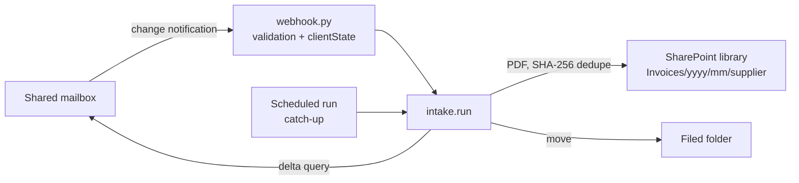

# m365-mail-intake

**Supplier invoices from a shared Microsoft 365 mailbox, filed into SharePoint automatically.**

Suppliers email invoices to `invoices@...`. Someone opens each email, saves the
PDF into the right SharePoint folder and moves the email out of the inbox. This
service does that with the Microsoft Graph API, never files the same invoice
twice, and never loses one when something fails halfway.



## What it shows

| Area | Where |
|---|---|
| **OAuth 2.0 client credentials** with Microsoft Entra ID, token caching | [`graph.py`](src/mail_intake/graph.py) |
| **Microsoft Graph**: mail delta queries, paging, attachments, SharePoint upload, message move | [`graph.py`](src/mail_intake/graph.py) |
| **Throttling**: 429/503 handled with `Retry-After` | [`graph.py`](src/mail_intake/graph.py) |
| **Change notifications (webhooks)**: validation handshake, `clientState` check, reply 202 and work in the background | [`webhook.py`](src/mail_intake/webhook.py) |
| **Reliable processing**: delta link only advances when a run fully succeeds; atomic state file; hash-based de-duplication | [`intake.py`](src/mail_intake/intake.py) |
| **Least-privilege permissions**: mailbox-scoped `Mail.ReadWrite`, `Sites.Selected` | [`docs/PERMISSIONS.md`](docs/PERMISSIONS.md) |
| **When Power Automate is the better tool** | [`docs/POWER-AUTOMATE.md`](docs/POWER-AUTOMATE.md) |

## Run it

```bash
pip install -e ".[dev]"
python -m pytest -q          # Graph is faked with httpx.MockTransport; no tenant needed
```

Against a real tenant (after the setup in `docs/PERMISSIONS.md`), set
`GRAPH_TENANT_ID`, `GRAPH_CLIENT_ID`, `GRAPH_CLIENT_SECRET`, `INTAKE_MAILBOX`,
`INTAKE_FILED_FOLDER_ID` and `INTAKE_DRIVE_ID`, then:

```bash
mail-intake                  # one run; schedule it, and/or trigger it from the webhook
```

## Notes

- Files up to 4 MB use a simple upload; larger files need an upload session
  (not built yet, see the changelog).
- Mail subscriptions expire within days. A scheduled job must renew them, and
  the scheduled catch-up run covers any notifications that were missed.
- Tested against a faked Graph API, not a live tenant. Mailbox and supplier names are fictional.

Built with Claude Code; see [`CLAUDE.md`](CLAUDE.md).

## Licence

MIT
